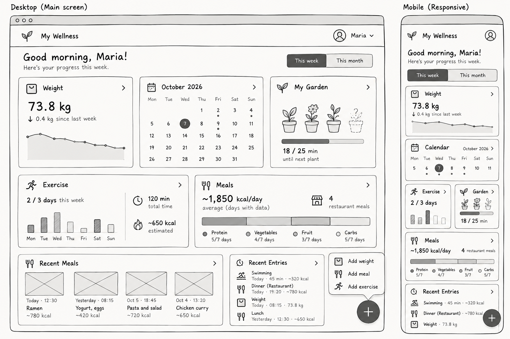

# Wireframes

Low-fidelity wireframes for the main screens of the wellness tracker.

The application is designed as a responsive web application. The main dashboard uses a card-based layout on desktop and reorganizes the same content vertically on smaller screens.

## Main Dashboard

The dashboard is the main screen of the application and provides access to the most important information without requiring separate navigation pages.

It includes:

- Weight and recent trend
- Calendar
- Exercise progress
- Meal summary
- Garden progress
- Recent entries
- A floating button for adding weight, meals, or exercise

### Responsive

