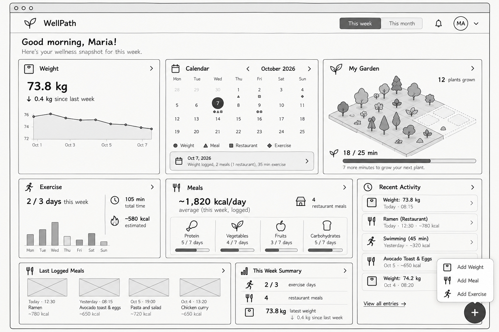
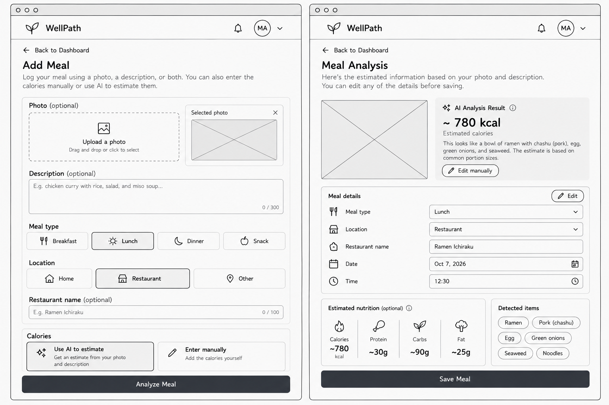
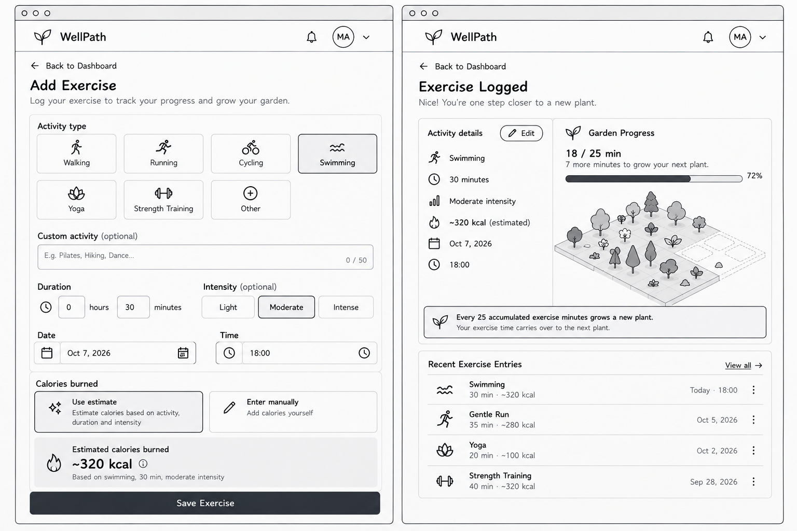
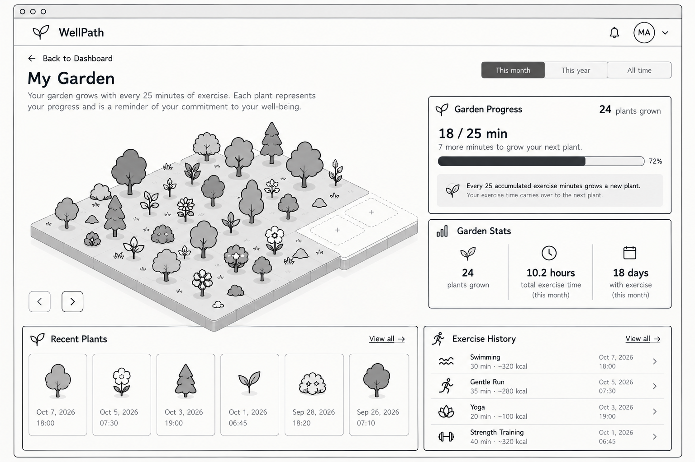
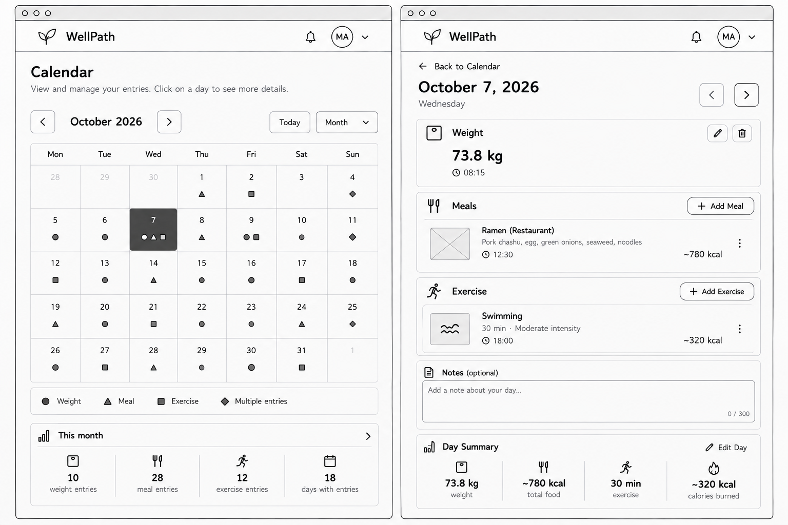
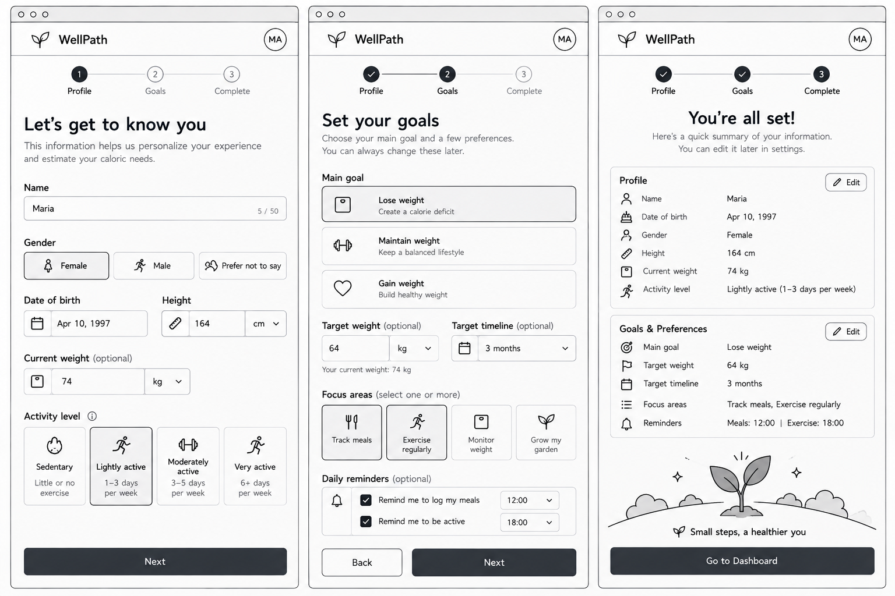

# Wireframes

Low-fidelity wireframes for the main screens of the wellness tracker.

The application is designed as a responsive web app. The dashboard acts as the main hub, using a card-based layout on desktop and reorganizing the same content for smaller screens.

## Main Dashboard

The dashboard provides an overview of the user's recent progress and quick access to the main tracking features.

It includes:

- Weight and recent trend
- Calendar
- Exercise progress
- Meal summary
- Garden preview
- Recent entries
- A floating button for adding weight, meals, or exercise

## Add Meal

Users can log a meal using text, a photo, or both.

The screen supports:

- Automatically suggested meal type, with manual override
- Location selection: home, restaurant, or other
- Optional restaurant name
- Meal description and photo
- Manual calorie entry or AI analysis
- Saving without AI analysis

AI-generated information can be reviewed and edited before the meal is saved.

## Add Exercise

Users can record an exercise session by selecting a common or custom activity and entering its duration and intensity.

The screen also allows users to:

- Review or change the date and time
- Use an estimated calorie value or enter one manually
- Save the exercise session

Exercise contributes to garden progress, with every 25 accumulated minutes growing a new plant.

## Garden

The garden provides a visual representation of accumulated exercise progress.

Plants remain in the garden over time, gradually filling the space as the user exercises. Remaining exercise minutes carry over toward the next plant.

The garden view includes:

- Plants grown so far
- Progress toward the next plant
- Total exercise time
- Number of exercise days
- Recent plants
- Related exercise history

The garden is designed as positive motivation rather than a streak system. Missing days does not remove plants or reset progress.

## Calendar & Day Detail

The calendar provides an overview of tracked activity. Simple indicators show days containing weight entries, meals, restaurant meals, or exercise sessions.

Selecting a day opens its activity details, where users can:

- View entries recorded on that date
- Open individual entries for more information
- Edit or delete entries
- Add a new entry with the selected date already filled in

Multiple entries of the same type can exist on the same day.

## Onboarding

New users complete a short onboarding process before accessing the dashboard.

### Profile

The user provides:

- Height
- Current weight
- Age
- Sex information used for estimates

The initial weight becomes the user's first weight entry.

### Goals

The user sets:

- Target weight
- Exercise days per week

After reviewing their information, the user completes onboarding and continues to the dashboard.

Onboarding data is saved only after the process is completed. Profile information and goals can be updated later.

